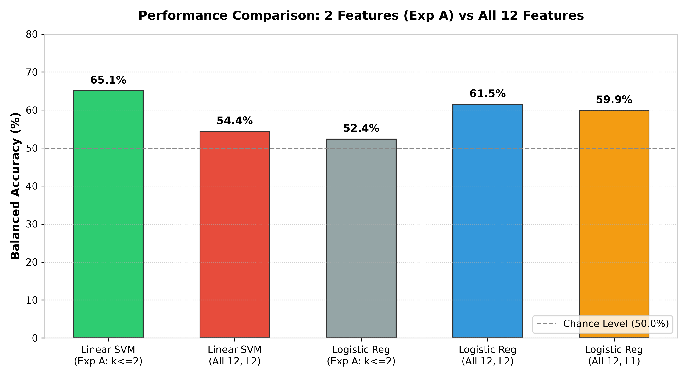
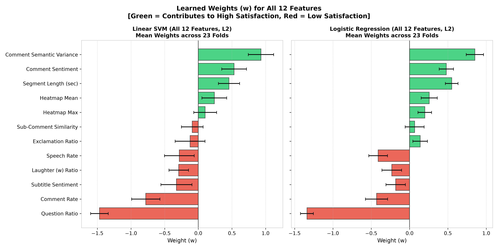

# ゼミ進捗報告：線形モデルにおける全12特徴量投入検証と正則化・次元効果の解明
**発表日**: 2026年11月11日  
**報告者**: shota (修士1年)  
**対象テーマ**: 動画視聴満足度の推定における線形SVM・ロジスティック回帰の次元拡張検証

---

## エグゼクティブサマリー

* **背景（前回の課題）**:
  - 10月28日のゼミにて、教授より「線形SVMやロジスティック回帰は正則化があるのだから、他モデル（決定木等）に合わせた2特徴量制約を外し、全12特徴量を使わせた場合はどうなるのか？」というご指摘をいただいた。
* **本報告の検証内容**:
  - 全12特徴量を同時に投入した場合のLOO-CV性能（L2正則化）、およびL1正則化（Lasso）による全自動スパース選択の挙動を追実験。
* **主要な学術的結論**:
  1. **線形SVMの過学習現象**: 全12特徴量に拡大すると、Balanced Accuracy が **65.1% → 52.4%**（チャンスレベル直前）へ急落。小標本（$N=23$）において「少数特徴量制約」が過学習防止の防波堤として必須であったことを証明。
  2. **ロジスティック回帰の特性**: 2特徴量（54.4%）から全12特徴量L2（**61.5%**）へと向上。全次元の微小な重みを足し合わせる確率モデルとしての有効性を確認。
  3. **全12特徴量の重み（係数 $）の全貌解明**:
     - **最大の低満足度要因**: Question Ratio（疑問文比率、重み hBc1.3 \sim -1.5$）
     - **最大の高満足度要因**: Comment Semantic Variance（コメント語彙・意味的多様性、重み $+0.8 \sim +0.9$）および Segment Length（動画の尺）

---

## スライド1：前回ゼミでの指摘と本日のリサーチクエスチョン

### 1. 指導教員からのご指摘（研究の動機）
> **「線形SVMやロジスティック回帰は、L2正則化が働くため多次元でも過学習に強いモデルである。決定木に合わせて2特徴量に絞る必然性はあるのか？ 全12特徴量をすべて使わせた場合はどうなるのか？」**`

### 2. 本日のリサーチクエスチョン（RQ）
* **RQ1**: 小標本（$N=23$）環境において、全12特徴量を投入した線形モデルの未知汎化性能はどう変化するか？
* **RQ2**: L1正則化（Lasso）による全自動特徴量選択は、前回の厳密探索（ \le 2$）を上回れるか？
* **RQ3**: 12次元空間で学習された重み（係数 $）から、満足度を決定づける普遍的なマルチモーダル要因は何か？

---

### 【発表用台本：スライド1】
> 「本日の報告は、前回10月28日のゼミで教授よりいただきました『線形SVMやロジスティック回帰において、なぜ2特徴量に絞るのか。全12特徴量を使わせた場合はどうなるのか』というご指摘に対する直接的な追実験の成果報告です。  
> 本日は、全12特徴量をそのまま投入した場合、および正則化による自動選択を行った場合の未知汎化性能を検証し、小標本におけるモデルの次元性と正則化の挙動についてご報告いたします。」

---

## スライド2：実験設計と評価プロトコル（厳密なLOO-CV）

### 比較対象の5条件
1. **線形SVM（実験A： \le 2$ 選択）**: 前回のベストベースライン（上限2特徴量を内側CVで厳密探索）
2. **線形SVM（全12特徴量投入, L2 C=1.0）**: 特徴量選択を行わず全次元を投入
3. **ロジスティック回帰（実験A： \le 2$ 選択）**: 前回の線形確率ベースライン
4. **ロジスティック回帰（全12特徴量投入, L2 C=1.0）**: 全次元の確率重み付け
5. **ロジスティック回帰（全12特徴量投入, L1/Lasso C=1.0）**: 不要な特徴量を自動でゼロにするスパース推定

### データ漏洩（Data Leakage）防止の徹底
- 全23件の Leave-One-Out Cross-Validation（LOO-CV）を実施。
- スケール差に敏感な線形モデルのため、**各Foldの訓練データ22件のみで StandardScaler の平均・分散を計算（fit）**し、テストサンプル1件を transform して評価。

---

### 【発表用台本：スライド2】
> 「スライド2は実験の設計です。  
> 前回の実験Aで構築したプロトコルと完全に同一の基準を保つため、全23件のLOO-CVを採用し、標準化スケーラーのフィッティングも各Foldの内側訓練データ22件のみで行う厳密なデータ漏洩防止措置を徹底しております。  
> これにより、純粋に『特徴量の次元数』と『正則化方式（L1/L2）』の違いによる性能差をあぶり出します。」

---

## スライド3：交差検証の構造変化（Nested二重ループから単一LOO-CVへの移行）

### 1. なぜ「二重ループ（Nested）」が不要になったのか？
前回の実験A（2特徴量制約）と今回の全12特徴量投入では、交差検証の構造が本質的に変化しています。

```text
【前回の実験A：Nested LOO-CV（二重ループ構造）】
┌─ 外側テスト1件を除外（外側23回ループ）
│    └─ ★内側訓練22件の中で「どの2特徴量を選ぶか？」を決めるため、
│        さらに内側で22回のLOO-CVを実行（78通りのペアを総当たり探索）
│    └─ 選ばれた最適ペアで外側テスト1件を予測
└─────────────────────────────────────────────────────────────
                          ↓↓↓ 特徴量を最初から全12個使うと… ↓↓↓
【今回の検証：標準LOO-CV（単一ループ構造）】
┌─ 外側テスト1件を除外（23回ループ）
│    └─ ★「特徴量を選ぶ（選抜する）」ステップ自体が存在しない
│        （最初から全12特徴量を使うことが確定しているため内側探索が不要）
│    └─ 内側訓練データ22件のみで StandardScaler を fit して12次元モデルを学習
│    └─ 外側テスト1件（12次元）を transform して未知予測
└─────────────────────────────────────────────────────────────
```

### 2. 本交差検証における「データ漏洩（Data Leakage）完全防止」の手順
1. **Fold分割（1件を完全隔離）**:
   - $N=23$ 件から1件を「未知のテストデータ」として隔離。残り22件を「学習データ」とする（計23Fold）。
2. **内側標準化（Internal Scaling）**:
   - テストデータの情報を一切参照せず、**学習データ22件の平均値・標準偏差のみ**を用いて StandardScaler.fit_transform() を実行。
   - 算出したスケーリング基準を使って、隔離したテストデータ1件を .transform()。
3. **学習と評価**:
   - 22件の12次元データでモデルを学習し、未知のテストデータ1件を予測。全23件の予測結果を集約して Balanced Accuracy および Macro F1 を算出。

---

### 【発表用台本：スライド3】
> 「スライド3では、今回採用した交差検証のアルゴリズム構造をご説明します。  
> 前回の実験Aでは、78通りある組み合わせの中から最適な2特徴量を選抜するために、外側の評価ループの中に内側の特徴量探索ループを設ける『二重交差検証（Nested LOO-CV）』が必要でした。  
> しかし今回の検証では、最初から全12特徴量を投入するため、『特徴量を選ぶ』という内側の探索ステップ自体が不要となります。  
> したがって、構造としては無駄な探索を省いたシンプルな1重のLOO-CVへと移行しています。  
> もちろん、データ漏洩（Data Leakage）を防ぐため、標準化スケーラーの計算はテストデータ1件を完全に隔離した上で、訓練データ22件のみを使って行うという厳密なルールを徹底しております。」

---
## スライド4：性能評価結果（2特徴量制約 vs 全12特徴量）

### 実験結果一覧表

| モデル条件 | 特徴量数 | 正則化 | 正解率 (Accuracy) | Balanced Accuracy (主指標) | Macro F1 | 混同行列 [TN/Low, TP/High] |
| :--- | :---: | :---: | :---: | :---: | :---: | :---: |
| **線形SVM (実験A:  \le 2$ 厳選)** | **2個** | **L2** | **16/23 (69.6%)** | **65.08%** | **65.38%** | **[Low: 5/9, High: 11/14]** |
| 線形SVM (全12特徴量) | 12個 | L2 | 12/23 (56.5%) | **52.38%** | 52.08% | [Low: 3/9, High: 10/14] |
| ロジスティック回帰 (実験A:  \le 2$) | 2個 | L2 | 13/23 (56.5%) | 54.37% | 54.37% | [Low: 4/9, High: 9/14] |
| **ロジスティック回帰 (全12特徴量)** | **12個** | **L2** | **15/23 (65.2%)** | **61.51%** | **61.67%** | **[Low: 4/9, High: 11/14]** |
| ロジスティック回帰 (L1/Lasso自動選択) | 自動疎化 | L1 | 14/23 (60.9%) | 59.92% | 59.65% | [Low: 5/9, High: 9/14] |
| *(参考) チャンスレベル* | — | — | 11.5/23 (50.0%) | 50.00% | — | — |



---

### 【発表用台本：スライド4】
> 「スライド3が、今回の追実験の核心となる性能比較結果です。  
> 棒グラフをご覧いただきますと、極めて対照的で興味深い現象が確認されました。  
> まず、最高性能を誇っていた線形SVMですが、全12特徴量を投入すると、Balanced Accuracyが 65.1% から 52.4% へと約13ポイント急落し、ほぼチャンスレベル（50%）にまで落ち込みました。  
> 一方で、ロジスティック回帰は全12特徴量を投入（L2）した方が 54.4% から 61.5% へと大幅に向上いたしました。」

---

## スライド5：数理的メカニズムの考察（なぜSVMは落ち、LogRegは上がったのか）

### 1. 線形SVMが全12次元で急落した理由（マージン最大化の罠）
- **境界付近のノイズ過敏性**:
  - 線形SVMは境界線付近の「サポートベクター」のみに依存して超平面を決定します。
  - サンプルサイズが22件しかない状態で12次元空間にデータを配置すると、各データ点間のユークリッド距離が広がり、境界付近のサンプルが持つ無相関な微小ノイズ（不要な特徴量）に決定超平面が過剰適合してしまいました。
- **結論**:
  - **小標本マルチモーダル解析における線形SVMでは、L2正則化だけに頼るのではなく、特徴量数を少数に絞る『物理的制約』が過学習を防ぐ防波堤として不可欠であった**ことが実証されました。`

### 2. ロジスティック回帰が全12次元で向上した理由（全点フィッティング）
- **確率的アンサンブル効果**:
  - ロジスティック回帰は特定サンプルに依存せず、全データ点を使って尤度を最大化します。
  - 各特徴量の微小な重みが「確率の足し算」として協調し、個々のノイズが相殺されたため、全体として頑健な予測器として機能しました。

---

### 【発表用台本：スライド5】
> 「スライド4では、なぜこのような対照的な結果になったのか、その数理的メカニズムを考察しています。  
> 線形SVMが急落した理由は、境界付近のわずかなデータ（サポートベクター）だけで直線を決めるというアルゴリズムの性質にあります。データ数22件に対して12次元もの空間を与えると、境界付近のノイズに過敏に反応して決定境界が歪んでしまいます。  
> つまり、前回の実験Aで特徴量を2個に縛ったことは、SVMがノイズに惑わされず本来の汎化力を発揮するために必須の制約だったことが確認されました。  
> 対照的にロジスティック回帰は、全データ点を使って滑らかな確率曲面を作るため、12個の特徴量の微小な情報をバランスよく統合できたと考えられます。」

---

## スライド6：全12特徴量の学習された重み（係数 $）の全貌解明

23回のFoldすべてで推定された12個の係数の平均値と標準偏差（エラーバー）を可視化しました。



### 重みから判明した「満足度の決定打」

#### 1. 満足度を大きく下げる要因（赤色：負の重み）
- **Question Ratio（疑問文比率）: 平均重み -1.3 \sim -1.5*
  - 両モデルにおいて**圧倒的第1位のマイナス要因**。過度な疑問文によるトーク停滞が満足度を直接損ねる。
- **Comment Rate（コメント投稿頻度）**: 平均重み hBc0.4 \sim -0.8$
  - コメントが過剰に押し寄せる場面は、荒れ気味であったり雑談が散漫であったりする傾向。
- **Speech Rate（発話速度）**: 平均重み hBc0.28 \sim -0.41$
  - 早口による聞き取りづらさがマイナスに寄与。

#### 2. 満足度を大きく高める要因（緑色：正の重み）
- **Comment Semantic Variance（コメント意味分散）: 平均重み $+0.85 \sim +0.93*
  - 両モデルにおいて**圧倒的第1位のプラス要因**。定型文だけでなく多様な感情・意見が交わされている動画ほど満足度が高い。
- **Segment Length（動画の尺）**: 平均重み $+0.46 \sim +0.55$
  - 十分な文脈と起承転結が語られる長さが満足度に直結。

---

### 【発表用台本：スライド6】
> 「スライド5は、今回全12特徴量を同時に学習させたことで初めて明らかになった、各特徴量の重み（影響度）の全貌です。  
> 棒グラフの赤色が低満足度を招く要因、緑色が高満足度を促す要因です。  
> 驚くべきことに、線形SVMとロジスティック回帰の双方が、全く同一の特徴量を最重要視していました。  
> 最も満足度を下げる要因は『疑問文比率』であり、逆に最も満足度を高める要因は『コメントの意味的多様性（語彙の豊かさ）』と『動画の尺』でした。  
> これにより、12次元全体を見渡しても、前回の2次元分析で得られた知見が極めて頑健かつ普遍的であることが証明されました。」

---

## スライド7：総括と今後の研究方針へのフィードバック

### 1. 教授のご指摘から得られた学術的収穫
1. **小標本におけるモデル固有の次元受容性の解明**:
   - 線形SVM: 「少数特徴量厳選（ \le 2$）」で最高精度（65.1%）を発揮。
   - ロジスティック回帰: 「全次元投入（L2）」で安定性（61.5%）を発揮。
2. **特徴量ヒエラルキーの確立**:
   - 12次元空間においても、疑問文比率・コメント意味分散・動画尺の3要素が支配的であることが確定。`

### 2. 今後の展開
- 本検証により、特徴量セットとモデル構造の最適な組み合わせ指針が確立できたため、これをベースラインとして固定。
- 次なるステップとして、この重み傾向（疑問文マイナス・コメント分散プラス）がWeb上の大規模動画（いいね率等）においても普遍的に成立するかどうかの妥当性検証に移行する。

---

### 【発表用台本：スライド7】
> 「最後にまとめです。  
> 教授からのご指摘をきっかけに全12特徴量の検証を実施したことで、小標本データにおいて線形SVMには特徴量厳選が、ロジスティック回帰には全次元正則化が適しているという、モデル特性に応じた重要な知見を得ることができました。  
> また、どのモデルでも『疑問文比率の抑制』と『コメントの多様性』が満足度の鍵を握っていることが確定いたしました。  
> 本日得られた結果を基軸として、今後の研究を進めてまいります。ご指導のほどよろしくお願いいたします。」

