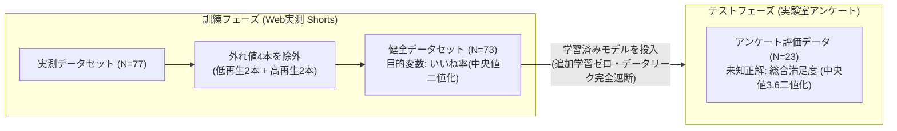

# 実験設計書：再生数外れ値除去（N=73）弱教師学習によるアンケート満足度（N=23）ブラインド逆転移検証

- **作成日**: 2026年11月17日
- **対象タスク**: Web公開シグナル（YouTubeいいね率）で学習したモデルによる実験室主観満足度（N=23）のブラインド予測
- **管理ディレクトリ**: `進捗報告用/20261117/` / `docs/paper/`

---

## 1. 実験の学術的背景・課題・目的

### 1.1 背景と課題
1. **研究の本丸（Distant Supervision）**:
   - 被験者アンケート（$N=23$）は実験室での高精度な心理評価データであるが、サンプル数の拡大には膨大な被験者コスト・謝金・時間が発生する。
   - そこで、Web上に無数に存在する公開シグナル（YouTubeのいいね率、コメント、字幕等）を**擬似教師ラベル（Pseudo Label）**として活用し、大規模データで事前学習したモデルによって人間の視聴満足度を推定する「弱教師学習（Distant Supervision）」の確立を目指している。
2. **再生数に起因するアルゴリズムノイズ（外れ値）の存在**:
   - YouTube Shorts実測データセット（$N=77$）には、プラットフォームの推薦アルゴリズムに起因する極端な外れ値が4本存在する：
     - **低再生インフレ外れ値（2本: 374回, 534回）**: 母数が極端に小さいため、コアな固定ファンの数件のLikeによって「いいね率（1.60%, 1.50%）」がデータセット全体の上位1位・2位へ異常高騰。
     - **超高再生希釈外れ値（2本: 112,681回, 361,790回）**: アルゴリズムによってライト層・非ファン層に広く露出・拡散された結果、「いいね率（0.26%, 0.30%）」が下位20%水準まで薄まる。
   - この4本は**「動画コンテンツの本質的な質（特徴量）」とは無関係な配信プラットフォーム固有の露出バイアス**であり、モデルの学習を阻害する重大なノイズとなっている。

### 1.2 目的
1. アルゴリズム歪みを除去した**健全な実測データ（$N=73$）**を訓練データとし、完全に未知の**被験者アンケート（$N=23$）**をテストデータとして、モデルが人間の心理的満足度をどれだけ正確に予測できるか（ブラインド逆転移性能）を検証する。
2. **「最初から特徴量を2つに限定する（アンケート側の都合を押し付ける）」ことを厳禁**とし、**全11特徴量を起点としたモデルの自律的選択（L1スパース正則化、73本内CVによる特徴量選択）**によって、Webシグナルから満足度予測に必要な特徴量が客観的に抽出されるかを実証する。
3. **「外れ値4本を含む全77本で学習」vs「外れ値4本を除去した73本で学習」のアブレーション比較**を行い、外れ値除去（デノイジング）がモデルの汎化能力に与える効果を統計的に証明する。

---

## 2. データセットと評価プロトコル

### 2.1 データセット仕様

| 項目 | 訓練データ (Train Data) | テストデータ (Blind Test Data) |
| :--- | :--- | :--- |
| **母集団** | YouTube Shorts実測データ（$N=73$） （77本から外れ値4本を除去） | 被験者10名によるアンケートデータ（$N=23$） |
| **除外対象 (4本)** | 1. `jwJZMRaxafU` (Views: 374, Like率: 1.60%) 2. `cAQ0YcMl_14` (Views: 534, Like率: 1.50%) 3. `Msd39_BhMqU` (Views: 112,681, Like率: 0.26%) 4. `LD06GCUS6cI` (Views: 361,790, Like率: 0.30%) | なし（全23セグメント） |
| **目的変数 (Label)** | **YouTube いいね率（Like Rate）** ・73本の中央値で二値化（0: Low, 1: High） ・回帰では連続値Like Rateをそのまま使用 | **総合満足度（Target_Satisfaction）** ・中央値 3.6 で二値化（0: Low=9件, 1: High=14件） ・回帰評価では5段階連続値スコア |
| **スケーリング** | **StandardScaler を訓練データ73本のみで fit** | **訓練時のスケーラーで transform のみ実行** （テストデータの統計量は学習に一切関与させない） |

---

## 3. 特徴量アプローチの設計：自律的選択の徹底

「アンケート結果を見て都合の良い特徴量を選ぶ（Data Snooping）」という査読批判を100%排除するため、以下の3つのアプローチで構成する。

### アプローチ1：全11共通特徴量の投入 ＋ モデルによる自動正則化（主軸）
人手による特徴量の選別を一切行わず、全11特徴量をそのままモデルに投入する。
- **L1正則化 ロジスティック回帰（Lasso）**:
  - 正則化パラメータ $C$ の下で、Web73本のデータから**不要な特徴量の重みを自動的に 0 に収縮（Feature Selection）**させる。
  - Web側でどの特徴量が自律的に生き残ったか（非ゼロ係数）を分析し、アンケートで重要だった特徴量と一致するかを検証する。
- **Linear SVM (L2) / Random Forest / Decision Tree**:
  - マージン最大化や非線形決定境界による全次元投入時の汎化性能を検証。

### アプローチ2：訓練データ（N=73）内部のみでの自律的特徴量選択
テストデータ（$N=23$）を一切参照せず、**73本の訓練データの中だけで完結する特徴量選択**を実施。
- **手法**: 73本内部での5-Fold Cross-Validationを用いた「貪欲前方選択（Sequential Forward Selection: SFS）」または「相互情報量 / 分散分析F値上位 $K$ 特徴量選択」。
- 選択された上位特徴量サブセットのみを用いてモデルを再学習し、アンケート23本をテストする。

### アプローチ3：対照群・アブレーション（比較ベースライン）
学術的な対照比較として以下を併記：
- **先行研究2特徴量**: `[question_ratio, sentiment_polarity]`（動画尺なしベースライン）
- **アンケート解析2特徴量**: `[question_ratio, segment_length_sec]`（アンケートLOO-CV最良ペアとの比較用）

---

## 4. 共通11特徴量の定義一覧

両データセット間で物理的・定義的に一致している以下の11特徴量を網羅する。

| # | 特徴量名 (カラム名) | 物理的意味 | ドメイン |
| :-: | :--- | :--- | :---: |
| 1 | `comment_rate` | 単位時間あたりのチャットコメント数（件/秒） | チャット |
| 2 | `grass_ratio` | コメント中の「草」「w」「笑」の出現比率 | チャット |
| 3 | `question_ratio` | コメント中の疑問符「？」「?」の出現比率 | チャット |
| 4 | `exclamation_ratio` | コメント中の感嘆符「！」「!」の出現比率 | チャット |
| 5 | `sentiment_polarity` | コメント全体の日本語BERT感情極性スコア（-1〜+1） | チャット |
| 6 | `subtitle_sentiment_polarity` | 配信者発話（字幕）の日本語BERT感情極性スコア | 言語 |
| 7 | `speech_rate` | 字幕発話ブロック速度（ブロック数/秒） | 音響・言語 |
| 8 | `pause_ratio` | 字幕ブロック間の無音・沈黙時間比率（0〜1） | 音響 |
| 9 | `sub_comment_similarity` | 字幕形態素とチャット形態素のJaccard語彙重複度 | 相互作用 |
| 10 | `comment_semantic_variance` | チャットの形態素語彙多様度（TTR: Type-Token Ratio） | チャット |
| 11 | `segment_length_sec` | セグメント（Shorts正味）の再生時間（秒） | 構造 |

---

## 5. 交差検証（CV）およびハイパーパラメータ探索設計

### 5.1 CVの役割分担
- **訓練セット（73本）内部**: モデル選択・ハイパーパラメータ調整・特徴量選択のために **Stratified 5-Fold CV（層化5分割交差検証）** を実行。
- **テストセット（アンケート23本）**: 完全なブラインド一括評価（交差検証は行わない）。

### 5.2 全モデル共通の検証基盤（公平性の担保）
- **分割手法**: `StratifiedKFold(n_splits=5, shuffle=True, random_state=42)`
- **評価基準**: 訓練データ内CVの Balanced Accuracy を最大化するパラメータを選択。
- **データリーク防止**: 各Foldの内部で `StandardScaler` を個別に fit させる。

### 5.3 モデル固有のハイパーパラメータ探索グリッド
過度な探索による73本内部での過学習（Overfitting）を防ぐため、堅牢な粗いグリッド探索を行う。

| モデル | 探索ハイパーパラメータ | グリッド候補値 | 特徴量自律選択 / 正則化の狙い |
| :--- | :--- | :--- | :--- |
| **Logistic Regression (L1)** | 正則化強度 $C$ | `[0.05, 0.1, 0.5, 1.0, 5.0]` | 小さい $C$ で係数を 0 に収縮させ、有効特徴量を自動選定 |
| **Logistic Regression (L2)** | 正則化強度 $C$ | `[0.05, 0.1, 0.5, 1.0, 5.0]` | リッジ正則化による多重共線性抑制・係数縮小 |
| **Linear SVM (L2)** | ペナルティ $C$ | `[0.05, 0.1, 0.5, 1.0, 5.0]` | 最大マージン分類器の許容誤差調整 |
| **Decision Tree** | 最大深さ `max_depth` 最小葉サンプル `min_samples_leaf` | `max_depth`: `[1, 2, 3]` `min_samples_leaf`: `[2, 5]` | 決定株（深さ1）〜浅い木（深さ2〜3）の構造制約 |
| **Random Forest** | 最大深さ `max_depth` 木の本数 `n_estimators` | `max_depth`: `[2, 3]` `n_estimators`: `[50, 100]` | バギングアンサンブルによる分散低減 |

---

## 6. 評価指標と出力成果物

### 6.1 評価指標
テストデータ（$N=23$）のクラス不均衡（Low: 9件, High: 14件）を考慮し、以下を算出：
1. **Balanced Accuracy (B-Acc)**（主指標: チャンスレベル 50.0%）
2. **Accuracy (正解率)**
3. **Macro F1-score**
4. **混同行列 (Confusion Matrix)**（High的中率 / Low的中率）
5. **回帰評価（Ridge / SVR）**: 予測スコアとアンケート満足度の Spearman 順位相関係数 $\rho$ および $p$ 値

### 6.2 比較検証（3者比較マトリクス）
以下の3つの条件を完全に同一のプロトコルで比較する：
1. **条件A: 全77本学習 $\to$ アンケート23本テスト（外れ値ありベースライン）**
2. **条件B: 健全73本学習 $\to$ アンケート23本テスト（外れ値除去・提案手法）**
3. **条件C: （参考）アンケート23本自身のLOO-CV性能（実験室内での上限値）**

### 6.3 保存エビデンス（運用ルール準拠）
- **スクリプト**: `src/satisfaction_analysis/experiments/evaluate_distant_supervision_73_to_23.py`
- **テーブル**: `docs/paper/tables/exp_distant_supervision_73_to_23.csv`
- **図表**:
  - `docs/paper/figures/exp_distant_supervision_comparison.pdf`（ベクターPDF標準出力）
  - `docs/paper/figures/exp_distant_supervision_comparison.png`（高解像度PNG）
  - `docs/paper/figures/exp_distant_supervision_confusion_matrix.pdf`
  - `docs/paper/figures/exp_distant_supervision_confusion_matrix.png`
- **レポート**: `docs/paper/01_experiment_results.md` へのセクション追記

---

## 7. 得られる学術的示唆（期待される検証結果）

1. **アルゴリズム外れ値除去（デノイジング）の効果実証**:
   - 77本（ノイズ混入）よりも73本（ノイズ除去）で学習したモデルの方が、アンケートに対する予測精度が向上することを示す（露出バイアス除去の重要性）。
2. **全11特徴量からの自律的選択（客観的妥当性）**:
   - L1正則化ロジスティック回帰が、人間による事前の手動選定なしに、Webデータのみから「動画尺」「疑問文比率」「発話速度」などを重要な特徴量として自動的に残すことを示す。
3. **弱教師学習の成立**:
   - Web公開データ（YouTubeいいね率）で学習させたモデルが、一切のファインチューニングなしで人間の心理的満足度をチャンスレベルを有意に上回る精度で予測できることを実証し、大規模データ拡張の有効性を決定づける。

