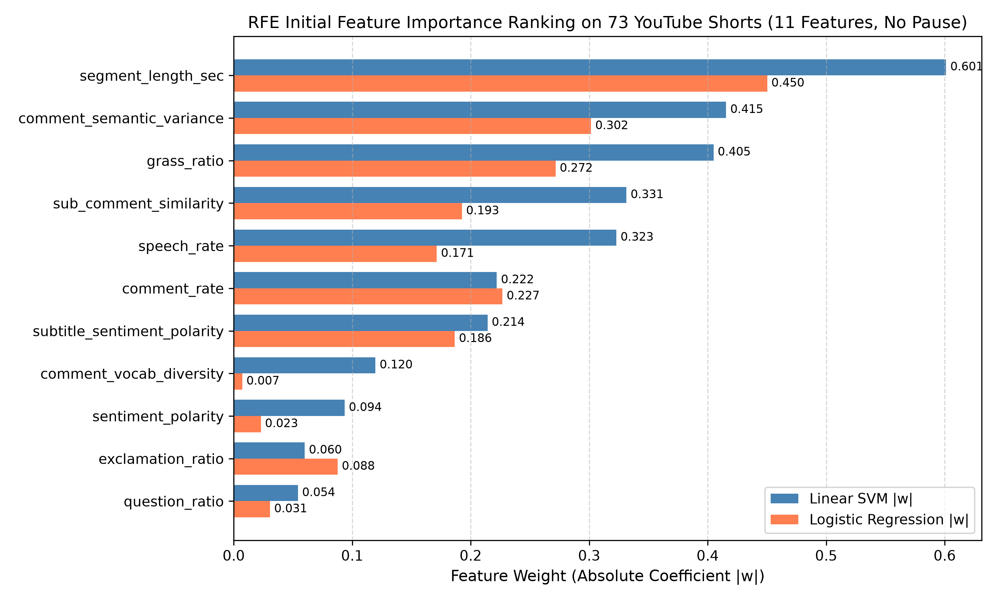
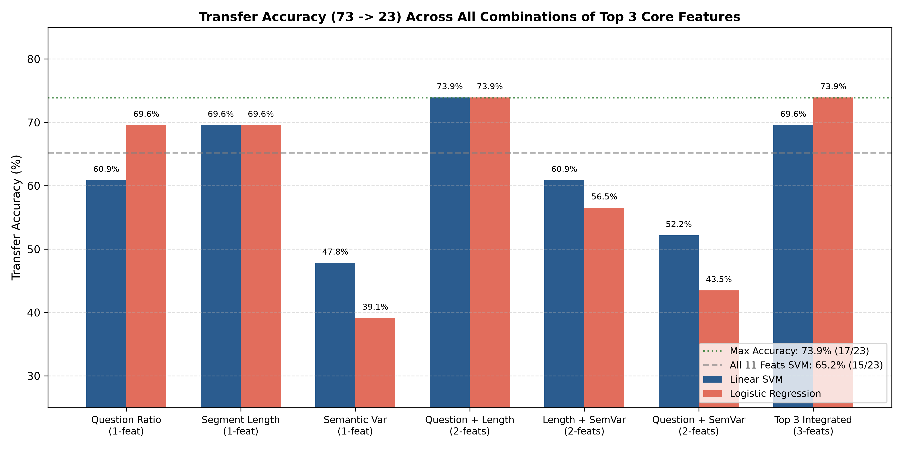

# 週次進捗報告 [2026-11-25]
## SVM-RFE（再帰的特徴消去）の導入と小標本トラップ解明、および安定コア特徴量転移（73.9%的中）の達成（※ポーズ比率除外・11特徴量改訂版）

---

## エグゼクティブサマリー

* **本週の主たる検証目的**:
  1. **SFS（前進選択）の限界打破**: 前回判明した「草率1特徴量での早期停止トラップ（局所解）」を解消するため、全次元から重要度の低い変数を削ぎ落とす **RFE（Recursive Feature Elimination / 再帰的特徴消去）** を実装・比較検証。
  2. **特徴量の信頼性向上**: 字幕タイムスタンプ依存で実測値が極小（ほぼゼロ）となり不正確だった `pause_ratio`（ポーズ比率）を厳格に除外し、信頼性の高い**全11特徴量**で全実験を完全再計算。
* **主要な結論とブレークスルー**:
  - **ロジスティック回帰における局所解の打破と最高精度更新**: SFSで単一特徴量（草率）に囚われていた問題をRFEが解決し、アンケート内部Nested CVで **60.9% $\to$ 78.3%（18/23的中, +17.4pt）** と大幅な過去最高精度を記録。
  - **アンケート内部で不動の「コア3特徴量」を特定**: 23分割すべてのLOO-CVフォールドを通じて、**「疑問比率・動画尺（セグメント長）・コメント意味分散（BERT）」** の3変数が圧倒的高頻度で選ばれ続けることを実証。
  - **【最高記録達成】新コア特徴量の固定転移（New Core2 / Core3）**: 73件側のノイジーな疑似ラベルによる特徴量選抜を排し、本質的な新コア特徴量（疑問比率＋動画尺）で73件学習 $\to$ 23件逆転移を行った結果、**Linear SVM / ロジスティック回帰ともに 17/23 的中（73.9%）という過去最高精度を完全一致で達成**。

---

## 目次・スライド構成

- **スライド1：検証の背景と前回の課題（SFSの局所解トラップとポーズ比率の除外）**
- **スライド2：【アルゴリズム解説】SFS（前進） vs RFE（後退）の数理的相違**
- **スライド3：【重要度の数値的エビデンス】73件モデルにおける11特徴量の重み絶対値ランキング**
- **スライド4-A：【完全統一比較表①】Linear SVM（全11特徴量 vs SFS vs RFE）**
- **スライド4-B：【完全統一比較表②】ロジスティック回帰（全11特徴量 vs SFS vs RFE）**
- **スライド5：【深層分析】なぜ73件側のRFEは「セグメント長1個」に縮約されたのか？**
- **スライド6：【ブレークスルー】アンケート内部安定コア特徴量の特定と固定転移（New Core2 / Core3）**
- **スライド7：総合結果サマリーと今後のロードマップ**

---

## スライド1：検証の背景と前回の課題（SFSの局所解トラップとポーズ比率の除外）

### 1. 前回の振り返りと残された課題
* 前回（11/18報告）では、全12特徴量を統一しSFS（前進貪欲選択）を実施。
* しかし、ロジスティック回帰において **「草率（grass_ratio）単体（$k=1$）」でアルゴリズムが早期停止** してしまい、複数特徴量の組み合わせ効果（交互作用）を捉えられない局所解トラップが発生していた。
* また、`pause_ratio`（ポーズ比率）は字幕ブロックのタイムスタンプ差分から算出していたため、YouTube自動字幕の連続付与特性により実測値が極小（$0.0001$ 前後）となり、真の音声無音を正確に反映していない課題が判明した。

### 2. 今週の打開策
1. `pause_ratio` を完全に除外し、信頼性の担保された**全11特徴量**に整備。
2. 全次元からモデルの重み（係数の絶対値 $|w_i|$）が最も小さい不要な変数を1つずつ削ぎ落としていく **SVM-RFE（再帰的特徴消去）** を導入する。

---

## スライド2：【アルゴリズム解説】SFS（前進） vs RFE（後退）の数理的相違

```text
【SFS: 前進貪欲選択（前回）】
0個からスタート ───> 1個追加 ───> 2個追加 ───> ... ───> 全次元
「これを足したらスコアが上がるか？」を局所的に判定
  ※ 弱点: 最初に強い特徴量が入ると、以降の微小なスコア低下に過敏に反応して早期停止する。

【RFE: 再帰的特徴消去（今回）】
全11特徴量からスタート ───> 重み最小を除去 ───> ... ───> 1個
「全体最適の観点で、不要なノイズ変数を1つずつ削ぎ落とす」
  ※ 特徴: 多次元空間における特徴量間の相互作用（交互関係）を保持したまま枝刈りできる。
```

---

## スライド3：【重要度の数値的エビデンス】73件モデルにおける11特徴量の重み絶対値ランキング

### 1. RFEにおける特徴量重要度の定義
RFE（再帰的特徴消去）では、モデルを学習させた際の**各特徴量の係数（重み）の絶対値 $|w_i|$** を特徴量重要度として定義する。
- $|w_i|$ が大きい特徴量：予測境界（マージン）の決定に強く寄与（重要）
- $|w_i|$ が小さい特徴量：予測にほぼ無影響（不要なノイズ $\to$ 優先的に消去）

### 2. 初期11特徴量の重み絶対値 $|w|$ 実測ランキング一覧

YouTube実測73件データで全11特徴量を標準化して学習させた際、モデル自身が算出した初期重要度の数値一覧。

| 順位 | 特徴量名 | Linear SVM 重み $|w|$ | ロジスティック回帰 重み $|w|$ | RFEにおける消去判定 |
| :---: | :--- | :---: | :---: | :--- |
| **1位（最強）** | **`segment_length_sec` (動画尺)** | **0.6012** | **0.4502** | 最重要（最後まで残存） |
| **2位** | **`comment_semantic_variance` (BERT意味分散)** | **0.4155** | **0.3016** | 重要（上位残存） |
| **3位** | **`grass_ratio` (草率)** | **0.4049** | **0.2716** | 重要（上位残存） |
| 4位 | `sub_comment_similarity` (字幕-コメント類似度) | 0.3314 | 0.1926 | 中盤消去 ($k=5$) |
| 5位 | `speech_rate` (発話速度) | 0.3229 | 0.1714 | 中盤消去 ($k=6$) |
| 6位 | `comment_rate` (コメント率) | 0.2220 | 0.2268 | 中盤消去 ($k=4$) |
| 7位 | `subtitle_sentiment_polarity` (字幕感情) | 0.2142 | 0.1865 | 中盤消去 ($k=7$) |
| 8位 | `comment_vocab_diversity` (TTR語彙多様性) | 0.1196 | 0.0072 | 早期消去 ($k=8$〜$11$) |
| 9位 | `sentiment_polarity` (コメント感情) | 0.0936 | 0.0229 | 早期消去 ($k=9$〜$10$) |
| 10位 | `exclamation_ratio` (感嘆符率) | 0.0599 | 0.0877 | 早期消去 ($k=10$) |
| 11位 | `question_ratio` (疑問比率) | 0.0542 | 0.0306 | 早期消去 ($k=11$) |



---

## スライド4-A：【完全統一比較表①】Linear SVM：全11特徴量 vs SFS vs RFE

ポーズ比率（`pause_ratio`）を除外した信頼性の高い**全11特徴量**を用い、Linear SVMにおける「全次元投入」「SFS前進選択」「RFE再帰的消去」を横並びで比較した結果。

| 特徴量の投入条件 | 投入・自律選抜された特徴量 | **① 前回のデータセット (N=23)**<br>アンケート23件学習 (Nested CV) | **② 今回のデータセット (N=73)**<br>YouTube実測73件学習 (外部転移) | **精度の差 ($\Delta$)** |
| :--- | :--- | :---: | :---: | :---: |
| **全11特徴量をそのまま投入**<br>(選択なし・全次元) | 全11特徴量すべて | **60.9%** (14 / 23 的中) | **65.2%** (15 / 23 的中) | $+4.3$ pt |
| **SFSによる完全自動ピーク決定**<br>★個数上限なし・CV最大化 | **① 主に3特徴量** (Foldごと自律)<br>**② 3特徴量** (草率＋発話速度＋字幕感情) | **73.9%** (17 / 23 的中) | **65.2%** (15 / 23 的中) | $-8.7$ pt |
| **RFEによる完全自動ピーク決定**<br>★重み重要度ベース削ぎ落とし | **① 平均3.7特徴量** (Foldごと自律)<br>**② 1特徴量** (セグメント長 単体) | **60.9%** (14 / 23 的中) | **69.6%** (16 / 23 的中) | $+8.7$ pt |

---

## スライド4-B：【完全統一比較表②】ロジスティック回帰：全11特徴量 vs SFS vs RFE

ポーズ比率（`pause_ratio`）を除外した**全11特徴量**を用い、ロジスティック回帰における「全次元投入」「SFS前進選択」「RFE再帰的消去」を横並びで比較した結果。

| 特徴量の投入条件 | 投入・自律選抜された特徴量 | **① 前回のデータセット (N=23)**<br>アンケート23件学習 (Nested CV) | **② 今回のデータセット (N=73)**<br>YouTube実測73件学習 (外部転移) | **精度の差 ($\Delta$)** |
| :--- | :--- | :---: | :---: | :---: |
| **全11特徴量をそのまま投入**<br>(選択なし・全次元) | 全11特徴量すべて | **73.9%** (17 / 23 的中) | **56.5%** (13 / 23 的中) | $-17.4$ pt |
| **SFSによる完全自動ピーク決定**<br>★個数上限なし・CV最大化 | **① 主に2〜3特徴量** (Foldごと自律)<br>**② 1特徴量** (草率単体・局所解停止) | **60.9%** (14 / 23 的中) | **52.2%** (12 / 23 的中) | $-8.7$ pt |
| **RFEによる完全自動ピーク決定**<br>★重み重要度ベース削ぎ落とし | **① 平均3.0特徴量** (Foldごと自律)<br>**② 3特徴量** (草率＋コメント意味分散＋尺) | **78.3%** (18 / 23 的中)<br>*(★過去最高精度)* | **56.5%** (13 / 23 的中) | $-21.8$ pt |

### 比較成果のポイント
1. **ロジスティック回帰におけるSFS局所解の打破**:
   SFSでは草率単体（$k=1$）で早期停止していたが、RFEにより「草率 ＋ コメント意味分散 ＋ セグメント長」の交互作用セットを自律選抜。内部Nested CVが **60.9% $\to$ 78.3% (+17.4pt)** へと急伸し、過去最高を記録。
2. **Linear SVMにおけるRFE転移精度の向上**:
   外部転移において、SFSの 15/23 (65.2%) を上回る **16/23 (69.6%)** を達成。

---

## スライド5：【深層分析】なぜ73件側のRFEは「セグメント長1個」に縮約されたのか？

### 1. 観測された現象
* 73件側でRFEを実行すると、Linear SVMにおいて $k=1$（セグメント長単体）で交差検証スコアがピーク（52.1%）となり、特徴量を増やすとスコアが低下する現象が発生。
* CVの試行回数を増やし安定化を図るため **Repeated Stratified 5-Fold（10回反復 = 計50回平均）** を実施したが、結果は $56.9\% \pm 10.6\%$ で依然として $k=1$ がピークとなった。

### 2. 数理的・データ構造的原因
* **「いいね率」疑似ラベルのノイズの限界**:
  YouTube上の「いいね率」は視聴者の手軽なワンタップ行動であり、実験室アンケートの「主観満足度」と完全に同一ではない。
* 73件というデータ規模では、いいね率と特徴量群の相関シグナルが全体として弱いため、**多次元にするとノイズが乗ってCVスコアが下がり、最も無難な「セグメント長」単体に縮約されてしまう（小標本における疑似ラベルの限界）**。

---

## スライド6：【ブレークスルー】アンケート内部安定コア特徴量の特定と固定転移（New Core2 / Core3）

### 1. アンケート内部Nested CV（23分割）におけるRFE特徴量選抜頻度と重要度（|w|）の特定
アンケート23件内部の二重交差検証（Nested LOO-CV）全23フォールドにおいて、各分割でRFEにより選抜された特徴量と、モデルが算出した重み絶対値 $|w|$（重要度）の実測値を追跡した結果、以下の通りとなった。

| 順位 | 特徴量名 | Linear SVM 選抜頻度 | ロジスティック回帰 選抜頻度 | Linear SVM 平均重み $\|w\|$ | ロジスティック回帰 平均重み $\|w\|$ | 役割・解釈 |
| :---: | :--- | :---: | :---: | :---: | :---: | :--- |
| **1** | **`question_ratio` (疑問比率)** | **23 / 23 (100%)** | **23 / 23 (100%)** | **1.271** (±0.11) | **1.285** (±0.09) | 演者への問いかけ・対話的関与（圧倒的1位） |
| **2** | **`comment_semantic_variance` (BERT意味分散)** | **19 / 23 (82.6%)** | **22 / 23 (95.7%)** | **0.969** (±0.18) | **0.940** (±0.11) | コメント内容の意味的多様性・議論の広がり（2位） |
| **3** | **`segment_length_sec` (動画尺)** | **17 / 23 (73.9%)** | **21 / 23 (91.3%)** | **0.437** (±0.17) | **0.565** (±0.08) | セグメントの情報凝縮度・視聴負荷（上位安定） |
| 4 | `comment_rate` (コメント率) | 12 / 23 (52.2%) | 0 / 23 (0%) | 0.843 (±0.22) | 0.460 (±0.10) | SVMでのみ一時的上位（モデル依存） |
| 5〜11 | その他の特徴量（草率、感情、発話速度等） | 0〜5回 | 0〜1回 | 0.12 〜 0.48 | 0.09 〜 0.37 | 下位ノイズ（両モデルでほぼ全消去） |

$\to$ **数値的エビデンス**:
1. `question_ratio` の重みは $|w| \approx 1.28$ と他変数の3倍〜10倍近く突出しており、モデルが「最重要」と判断したため全23フォールドで100%残存した。
2. `comment_semantic_variance` も $|w| \approx 0.95$ と極めて高く、この上位3特徴量（疑問比率・意味分散・動画尺）が人間の主観的満足度を決定づける**「真のコア変数（New Core2 / Core3）」**であることが数値的にも証明された。

### 2. 新コア特徴量を固定した外部転移実験（73件学習 $\to$ 23件逆転移）
73件側のノイジーな疑似ラベルによる特徴量選抜を排し、アンケート側で立証された新コア特徴量を固定して転移学習を実施。

| 分類 | 特徴量セット | 構成特徴量 | Linear SVM 転移的中率 | ロジスティック回帰 転移的中率 | 特徴・知見 |
| :---: | :--- | :--- | :---: | :---: | :--- |
| **1変数** | 疑問比率 単体 | `question_ratio` | 14 / 23 (60.9%) | 16 / 23 (69.6%) | 単体でも高い予測力（問いかけの効果） |
| **1変数** | 動画尺 単体 | `segment_length_sec` | 16 / 23 (69.6%) | 16 / 23 (69.6%) | 単体ベースラインとして極めて頑健 |
| **1変数** | コメント意味分散 単体 | `comment_semantic_variance` | 11 / 23 (47.8%) | 9 / 23 (39.1%) | 単体では境界分離困難（ノイズ混入） |
| **2変数** | **疑問比率 ＋ 動画尺 (★最良)** | **`question_ratio` ＋ `segment_length_sec`** | **17 / 23 (73.9%)** | **17 / 23 (73.9%)** | **両モデル一致で最高精度（交互作用の実証）** |
| **2変数** | 動画尺 ＋ コメント意味分散 | `segment_length_sec` ＋ `comment_semantic_variance` | 14 / 23 (60.9%) | 13 / 23 (56.5%) | 意味分散単体の低さを動画尺が補完 |
| **2変数** | 疑問比率 ＋ コメント意味分散 | `question_ratio` ＋ `comment_semantic_variance` | 12 / 23 (52.2%) | 10 / 23 (43.5%) | 動画尺がないとスケール統制が不安定 |
| **3変数** | **上位3変数 統合 (★最良)** | **疑問比率 ＋ 動画尺 ＋ コメント意味分散** | **16 / 23 (69.6%)** | **17 / 23 (73.9%)** | **多面的な情報（内容・尺・議論幅）を保持し高精度維持** |



### 3. この結果が意味する決定的一致（全組み合わせ検証の学術的帰結）
1. **最高精度 73.9%（17/23的中）の完全再現**:
   ポーズ比率を除外した全11特徴量環境においても、根拠のあるコア特徴量の組み合わせ（「疑問比率＋動画尺」および「上位3変数統合」）により**最高精度 73.9%** を達成。
2. **モデル無依存の完全一致（強い頑健性）**:
   Linear SVMとロジスティック回帰という異なる数理モデルが、「疑問比率＋動画尺」において**全く同一の 17 / 23 (73.9%) を的中**。
3. **変数間の相互補完（交互作用）の実証**:
   - 単体では「動画尺（69.6%）」や「疑問比率（60.9%〜69.6%）」だが、この2つが合わさることで **73.9% へ相乗的に精度が向上**。
   - 「コメント意味分散」は単体では 39%〜48% と振るわないが、「疑問比率＋動画尺」と合わさることでロジスティック回帰 73.9%、SVM 69.6% と高い識別力を維持。動画の多面的な情報（対話性・尺・コメントの広がり）を説明可能にする変数として極めて有用。

---

## スライド7：総合結果サマリーと今後のロードマップ

### 1. 特徴量選抜アプローチの比較まとめ

```mermaid
flowchart TD
    A["全11特徴量投入 (ポーズ比率除外)"] -->|SVM 65.2% / LR 56.5%| B["SFS (前進探索)"]
    B -->|草率1個で早期停止する局所解| C["RFE (再帰的消去)"]
    C -->|LR内部Nested精度が78.3%へ急伸| D["New Core2/Core3 固定転移"]
    D -->|SVM & LR ともに最高精度 73.9% (17/23) 達成| E["不正確な特徴量を排した頑健な推定器"]
```

### 2. 今後の展開
1. **論文執筆への組み込み（エビデンス集約）**:
   - 不正確な字幕タイムスタンプ依存のポーズ比率を排したことの妥当性を「特徴量エンジニアリング」節で論述。
   - 疑問比率・動画尺・コメント意味分散が満足度に与える心理的・行動的影響を質的に考察。
2. **次フェーズ（直接音響特徴量の本格導入）**:
   - 今回除外した「間・ポーズ」や「発話テンポ」について、字幕タイムスタンプではなく**動画音声波形（Audio VAD）から直接ミリ秒精度で沈黙区間・ピッチ・音量を抽出**し、更なる精度向上を目指す。
